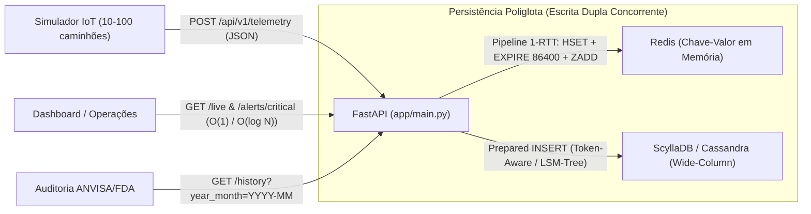

# PulseFleet — Marco 2 (Sistema Completo e Funcional)

Plataforma de **telemetria IoT em tempo real e auditoria regulatória (ANVISA/FDA)** para transporte refrigerado de vacinas, fármacos e cargas perecíveis, implementada com **Persistência Poliglota NoSQL** (**Redis** + **ScyllaDB/Cassandra** + **FastAPI**).

---

## 1. Visão Geral e Volumetria (Herdado do Marco 1)

Cargas farmacêuticas sensíveis exigem manutenção rigorosa da cadeia fria entre **$2^\circ\text{C}$ e $8^\circ\text{C}$**. Qualquer desvio térmico precisa disparar alertas operacionais em milissegundos e, simultaneamente, ficar registrado em uma trilha histórica imutável para fiscalização sanitária.

| Dimensão | Estimativa de Produção (Marco 1) |
| :--- | :--- |
| Frota monitorada | 10.000 veículos refrigerados |
| Frequência de envio | 1 pacote a cada 5 segundos por veículo |
| Vazão sustentada | **~2.000 escritas/segundo** (picos > 5.000 ops/s) |
| Volume diário | **~172,8 milhões de eventos/dia** (~5,18 bilhões/mês) |
| Faixa térmica segura | $2{,}0^\circ\text{C} \le T \le 8{,}0^\circ\text{C}$ |
| Retenção regulatória | 5 anos (TTL padrão de `157.680.000` segundos no ScyllaDB) |

---

## 2. Arquitetura de Persistência Poliglota



### Mapeamento Teoria (Marco 1) -> Código (Marco 2)

| Conceito Teórico (Marco 1) | Onde está implementado neste repositório |
| :--- | :--- |
| **Persistência Poliglota** | `app/main.py` (`ingest_telemetry` grava concorrentemente no Redis e no ScyllaDB via `asyncio.gather`) |
| **Estado Instantâneo $O(1)$ + TTL** | `app/main.py` (`HSET frota:veiculo:{id}:status` + `EXPIRE 86400` em pipeline único) |
| **Ranking de Desvio Térmico** | `app/main.py` (`ZADD frota:alertas:temperatura` + leitura por `ZREVRANGE` e `ZREVRANGEBYSCORE`) |
| **LSM-Tree & Escrita Append-Only sem Locks** | `init-scripts/init-cassandra.cql` (`TimeWindowCompactionStrategy` + `INSERT` imutável em `vehicle_telemetry`) |
| **Eliminação de JOINs (Query-Driven Modeling)** | `init-scripts/init-cassandra.cql` (tabela desnormalizada exatamente no formato da consulta regulatória) |
| **Partition Key Composta + Bucketing Mensal** | `PRIMARY KEY ((vehicle_id, year_month), timestamp)` evita partições > 100 MB (~518k eventos/veículo/mês) |
| **Ordenação Física Decrescente (Clustering Key)** | `WITH CLUSTERING ORDER BY (timestamp DESC)` elimina ordenação em memória nas consultas de histórico |
| **Hash Consistente (Murmur3) + Token-Aware Routing** | `app/database.py` (`TokenAwarePolicy(DCAwareRoundRobinPolicy())` + `PreparedStatement`) |
| **Bloqueio de Full-Scan (`ALLOW FILTERING`)** | `app/main.py` exige `year_month` obrigatório via regex `^\d{4}-(0[1-9]\|1[0-2])$` no endpoint `/history` |

---

## 3. Estrutura do Projeto

```text
pulsefleet-marco2/
├── docker-compose.yml          # Orquestração de Redis, ScyllaDB, scylla-init, FastAPI e simulador opcional
├── init-scripts/
│   └── init-cassandra.cql      # DDL do keyspace pulsefleet e tabela vehicle_telemetry
├── app/
│   ├── Dockerfile              # Imagem Python 3.11 enxuta para API e simulador
│   ├── requirements.txt        # FastAPI, Uvicorn, Pydantic, redis-py, cassandra-driver, httpx
│   ├── database.py             # Singleton com retry loop, TokenAwarePolicy e Prepared Statements
│   ├── main.py                 # API REST (ingestão, estado live, ranking crítico, histórico)
│   └── simulator.py            # Simulador IoT concorrente (10-100 caminhões + anomalias térmicas)
├── scripts/
│   ├── demo_queries.ps1        # Script interativo em PowerShell (Windows) para a demonstração ao vivo
│   └── demo_queries.sh         # Script interativo em Bash (Linux/macOS/Git Bash) para a demonstração ao vivo
└── README.md                   # Documentação completa e roteiro do seminário (10-12 min)
```

---

## 4. Como Executar o Ambiente

### Pré-requisitos
- **Docker** e **Docker Compose V2** (`docker compose version`)
- *(Opcional)* `curl` e `jq` (ou Python) para formatar JSON no terminal

### Passo 1 — Subir a stack completa (Redis + ScyllaDB + DDL + API)

```bash
cd pulsefleet-marco2
docker compose up --build -d
```

> **Tempo de boot:** O Redis fica saudável em ~3s; o ScyllaDB leva cerca de 20–35s na primeira inicialização. O container `scylla-init` aplica automaticamente o arquivo `init-scripts/init-cassandra.cql` e a API (`app`) possui retry loop interno até ambos os bancos responderem.

Acompanhe a inicialização até `pulsefleet-api` aparecer como `healthy`:

```bash
docker compose ps
docker compose logs -f app
```

Acesse a documentação interativa Swagger em: **http://localhost:8000/docs**

### Passo 2 — Iniciar o Simulador de Carga IoT

Você pode rodar o simulador de **três formas**:

**Opção A — Dentro do próprio container da API (mais simples na apresentação):**
```bash
docker compose exec app python simulator.py --url http://localhost:8000 --vehicles 25 --interval 1.5
```

**Opção B — Via profile dedicado do Docker Compose:**
```bash
docker compose --profile simulator up
```

**Opção C — Diretamente na máquina host (com Python + `httpx` instalado):**
```bash
python app/simulator.py --url http://localhost:8000 --vehicles 30 --interval 1.2
```

> O simulador injeta propositalmente desvios térmicos em 3 caminhões para que o painel de alertas fique imediatamente visível:
> - `VEIC-1024`: falha no compressor (**$9{,}2^\circ\text{C}$ a $14{,}8^\circ\text{C}$** — crítico quente)
> - `VEIC-1007`: vedação comprometida (**$8{,}3^\circ\text{C}$ a $11{,}2^\circ\text{C}$** — alerta quente)
> - `VEIC-1013`: termostato travado (**$-1{,}4^\circ\text{C}$ a $1{,}5^\circ\text{C}$** — risco de congelamento)

### Passo 3 — Executar o Script de Demonstração

**Windows PowerShell (recomendado no Windows):**
```powershell
.\scripts\demo_queries.ps1
```
*(Para rodar todas as etapas sem pausas: `.\scripts\demo_queries.ps1 -Auto`)*

**Linux / macOS / Git Bash / WSL:**
```bash
chmod +x scripts/demo_queries.sh
./scripts/demo_queries.sh
```
*(Para rodar todas as etapas sem pausas: `./scripts/demo_queries.sh --auto`; no Windows com Git Bash: `& "C:\Program Files\Git\bin\bash.exe" ./scripts/demo_queries.sh`)*

---

## 5. Referência dos Endpoints REST e Inspeção Direta nos Bancos

### Endpoints REST (`http://localhost:8000`)

| Método | Endpoint | Camada NoSQL | Descrição |
| :--- | :--- | :--- | :--- |
| `GET` | `/health` | Redis + ScyllaDB | Verifica saúde real das duas camadas |
| `POST` | `/api/v1/telemetry` | Redis + ScyllaDB | Ingestão poliglota, calcula `violation` e `year_month` |
| `GET` | `/api/v1/vehicles/{vehicle_id}/live` | Redis (`HGETALL` + `TTL`) | Estado instantâneo do veículo em $O(1)$ |
| `GET` | `/api/v1/alerts/critical?limit=10&min_temp=8.0` | Redis (`ZREVRANGE` / `ZREVRANGEBYSCORE`) | Ranking de veículos mais quentes ou acima de `min_temp` |
| `GET` | `/api/v1/vehicles/{vehicle_id}/history?year_month=2026-11&limit=50` | ScyllaDB (`SELECT` por Partition Key) | Série temporal imutável ordenada por `timestamp DESC` |

### Exemplos rápidos (`curl`)

```bash
# 1. Ingerir uma leitura com violação térmica
curl -X POST http://localhost:8000/api/v1/telemetry \
  -H "Content-Type: application/json" \
  -d '{
    "vehicle_id": "VEIC-1024",
    "timestamp": "2026-11-24T08:30:00Z",
    "latitude": -15.7942,
    "longitude": -47.8822,
    "speed": 72.5,
    "temperature": 9.4
  }'

# 2. Consultar estado em tempo real (Redis)
curl http://localhost:8000/api/v1/vehicles/VEIC-1024/live

# 3. Consultar ranking de desvios térmicos acima de 8.0 C (Redis Sorted Set)
curl "http://localhost:8000/api/v1/alerts/critical?limit=10&min_temp=8.0"

# 4. Consultar histórico regulatório (ScyllaDB - Partition Key completa obrigatória)
curl "http://localhost:8000/api/v1/vehicles/VEIC-1024/history?year_month=2026-11&limit=20"
```

### Comandos Diretos nos Bancos (Redis CLI e CQLSH)

```bash
# --- REDIS CLI ---
# Estado instantâneo do caminhão (Hash)
docker compose exec redis redis-cli HGETALL frota:veiculo:VEIC-1024:status

# Verificar expiração automática de 24h (86400s)
docker compose exec redis redis-cli TTL frota:veiculo:VEIC-1024:status

# Top 10 veículos mais quentes (Sorted Set)
docker compose exec redis redis-cli ZREVRANGE frota:alertas:temperatura 0 9 WITHSCORES

# Somente veículos em violação acima de 8.0 C
docker compose exec redis redis-cli ZREVRANGEBYSCORE frota:alertas:temperatura +inf 8.0 WITHSCORES

# --- SCYLLADB / CASSANDRA CQLSH ---
# Conferir estrutura física da tabela (Clustering Order DESC + TWCS)
docker compose exec scylla cqlsh -e "DESCRIBE TABLE pulsefleet.vehicle_telemetry;"

# Consulta auditável com TRACING ON (evidenciando leitura direta na partição sem ALLOW FILTERING)
docker compose exec scylla cqlsh -e "
TRACING ON;
SELECT vehicle_id, year_month, timestamp, temperature, speed, violation
FROM pulsefleet.vehicle_telemetry
WHERE vehicle_id = 'VEIC-1024' AND year_month = '2026-11'
LIMIT 10;
"
```

> **Windows PowerShell:** Todos os comandos `docker compose exec ...` acima funcionam diretamente no PowerShell; para testar a API sem `curl` POSIX, use `Invoke-RestMethod http://localhost:8000/api/v1/alerts/critical`.

### Encerrar e Limpar o Ambiente

```bash
# Parar mantendo os volumes de dados
docker compose down

# Parar removendo também os volumes (estado limpo para novo ensaio)
docker compose down -v
```

---

## 6. Roteiro Estruturado para a Apresentação (10 a 12 minutos)

Prepare **2 terminais lado a lado** (Terminal A com o simulador rodando e Terminal B para executar `scripts/demo_queries.sh`) + navegador aberto em `http://localhost:8000/docs`.

### Bloco 1 — Problema e Volumetria (2 minutos)
- **Contexto:** Transporte de vacinas e biológicos sob regulação ANVISA/FDA exige controle térmico estrito ($2^\circ\text{C}$ a $8^\circ\text{C}$). Uma única excursão térmica não detectada invalida lotes milionários.
- **Números do Marco 1:** 10.000 caminhões × 1 pacote a cada 5s = **~2.000 ops/s** e **~172,8 milhões de eventos/dia** (~5,18 bilhões/mês).
- **Dois padrões de acesso conflitantes:**
  1. *Painel operacional:* precisa do último estado de cada caminhão e do ranking dos mais quentes em poucos milissegundos.
  2. *Auditoria regulatória:* precisa recuperar o histórico cronológico completo e imutável de um veículo em determinado mês.
- **Por que um SGBD relacional único sofre aqui?** Contenção de locks em B-Trees sob 2.000 `INSERT`/`UPDATE`/s, crescimento acelerado de índices secundários e custo elevado de sharding horizontal.

### Bloco 2 — Justificativas NoSQL e Teorema CAP / BASE (3 minutos)
- **Persistência Poliglota:** Em vez de forçar um único motor, especializamos duas camadas:
  - **Redis (Chave-Valor em memória):**
    - `Hash` (`frota:veiculo:{id}:status`) com `EXPIRE 86400`: leitura $O(1)$ do estado vivo e limpeza automática de veículos ociosos.
    - `Sorted Set` (`frota:alertas:temperatura`): mantém o ranking contínuo em $O(\log N)$ e permite `ZREVRANGEBYSCORE +inf 8.0` instantaneamente.
  - **ScyllaDB / Cassandra (Wide-Column):**
    - Motor baseado em **LSM-Tree** (CommitLog sequencial + Memtable -> SSTables imutáveis), convertendo escritas aleatórias em I/O sequencial sem locks.
    - **Partition Key Composta `((vehicle_id, year_month))`:** hash consistente (Murmur3) distribui a carga no anel e o bucket mensal impede partições gigantes (> 100 MB).
    - **Clustering Key `timestamp DESC`:** dados já gravados fisicamente do mais recente para o mais antigo, dispensando `ORDER BY` em memória e eliminando JOINs.
- **Teorema CAP / PACELC e BASE:**
  - **ScyllaDB/Cassandra** é orientado a **AP (Disponibilidade + Tolerância a Partições)** com **Consistência Ajustável (Tunable Consistency)**. Em produção com `RF=3` (`NetworkTopologyStrategy`), adota-se `LOCAL_QUORUM` ($W + R > N$) para auditorias confiáveis; localmente usamos `RF=1` (`ONE`) para demonstração.
  - **Modelo BASE:** Alta disponibilidade na ingestão (*Basically Available*), estado volátil em cache com TTL (*Soft State*) e convergência assíncrona entre camadas (*Eventual Consistency*).

### Bloco 3 — Live Demo do Sistema e Queries nos Bancos (5 minutos)
1. **(0:30)** Mostrar `docker compose ps` com os containers saudáveis (`redis`, `scylla`, `app`) e abrir o Terminal A rodando o simulador:
   ```bash
   docker compose exec app python simulator.py --url http://localhost:8000 --vehicles 25 --interval 1.5
   ```
   Apontar o log ao vivo com vazão (`ops/s`), contagem de violações e `VEIC-1024` liderando o pico de calor.
2. **(1:30)** No Terminal B, rodar `./scripts/demo_queries.sh` (etapas 1 a 5):
   - Mostrar `/health`, `POST /api/v1/telemetry` (evidenciando latências paralelas de Redis e ScyllaDB em milissegundos), `/live`, `/alerts/critical?min_temp=8.0` e `/history?year_month=...`.
3. **(1:30)** Etapa 6 do script — **Inspeção direta no Redis CLI:**
   - `HGETALL frota:veiculo:VEIC-1024:status` (campos gravados e `violation = true`).
   - `TTL frota:veiculo:VEIC-1024:status` (contagem regressiva a partir de `86400` segundos).
   - `ZREVRANGE` e `ZREVRANGEBYSCORE +inf 8.0` mostrando `VEIC-1024` e `VEIC-1007` no topo em tempo real.
4. **(1:30)** Etapa 7 do script — **Inspeção direta no ScyllaDB (`cqlsh`):**
   - `DESCRIBE TABLE` destacando `PRIMARY KEY ((vehicle_id, year_month), timestamp)`, `CLUSTERING ORDER BY (timestamp DESC)` e `TimeWindowCompactionStrategy`.
   - `TRACING ON` + `SELECT ... WHERE vehicle_id='VEIC-1024' AND year_month='...' LIMIT 5`: provar ordenação decrescente física sem `ALLOW FILTERING`.
   - Mostrar o erro proposital ao omitir `year_month` na cláusula `WHERE` (o próprio banco impede queries que causariam full-cluster scan!).

### Bloco 4 — Lições Aprendidas e Trade-offs (2 minutos)
- **Escrita Dupla (Dual-Write) sem transação distribuída:** No protótipo, a API grava em paralelo no Redis e no ScyllaDB. Em produção massiva, o próximo passo evolutivo é introduzir **Apache Kafka / Redpanda** como barramento durável (desacoplando ingestão dos consumidores Redis e ScyllaDB e garantindo *at-least-once delivery*).
- **Rigidez de consultas no Wide-Column:** No Cassandra/ScyllaDB, a modelagem é guiada pela consulta (*Query-Driven*). Novas perguntas analíticas (ex.: "todas as violações de um estado") exigem novas tabelas materializadas ou pipelines analíticos (Spark/ClickHouse).
- **Custo operacional vs. ganho de escala:** Manter duas tecnologias NoSQL aumenta a complexidade de observabilidade e backup, mas entrega latência sub-milissegundo no monitoramento ao vivo e escalabilidade linear em séries temporais massivas.
